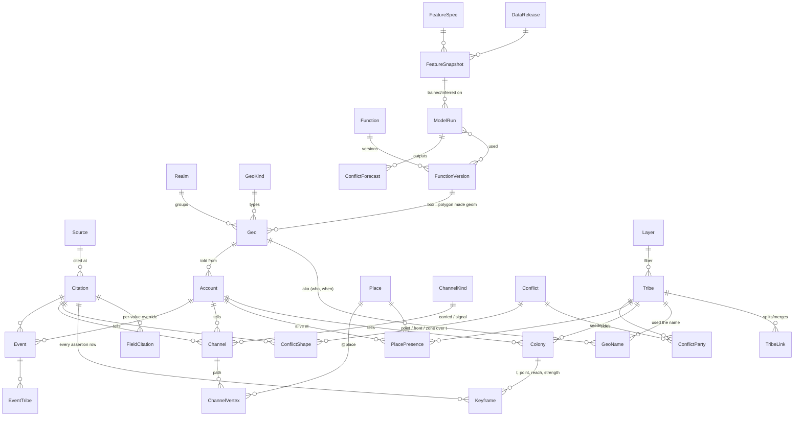

# ADR-0003 — The Tribes of Behavior atlas: a database of told histories

- **Status:** proposed — **draft for discussion, nothing built.** No tables or migrations until Jeremy agrees to the shape.
- **Proposed:** 2026-10-25
- **Extends:** [ADR-0001](0001-workshop-architecture.md). The database lives in the Django spine (`~/core/roofbeam-api`, served at `api.roofbeam.net`); the public toy stays static and reads exported JSON.
- **Toy it serves:** `toys/tribes/` (`bundles.json`, `geos.json`, `index.html`, `geos.html`)
- **Vault reasoning:** `Builder Vault/Efforts/Roofbeam/` (the theory itself is not restated here)

## Context: what he asked for, in his words

> "all the parameters we talked about, with reference to the historian or the artifact, the source of that data"

> "if there's a function drawing the coverage, the geography, the polynomial, we want that function stored in the database"

Later, the plan is to "add points of conflict and fronts of conflict from the literature", then "do some machine learning and see if we can predict points of conflict", training on the history and running inference.

What exists today is one hand-authored file. `bundles.json` holds Iberia, told from the `iberia` geo, from 1100 BCE to 2025: 49 tribes across four fibers, 41 channels, 31 events, and 18 portals. `geos.json` holds 122 overlapping arenas as boxes. All of it is schematic, sourced only as "from general histories". The rendering rules live as JS in the page:

| rule | where it lives today | what it is |
|---|---|---|
| interpolation | `index.html` `at()` | Linear between keyframes in year. A colony does not exist outside its first and last keyframe. |
| kernel | `index.html` `presence()`, `fieldGrid()` | Each colony adds `w·(1−(d/r)²)²` for `d < r`, where `d` is great-circle distance on a 6371 km sphere. Colonies of a tribe sum. |
| contours | `index.html` | Outer edge at 0.18, core at 0.62. |
| box → polygon | `geos.html` `boxFeature()` | Walks the box edges in 2° steps along parallels and meridians. Crosses the antimeridian when west > east. A `cap: "south"` box becomes a polar circle. |
| coverage | `geos.html` | A 1° land raster. Each cell counts the land geos whose boxes claim it (seas and corridors excluded) and is weighted by cos(lat). |

## Decision (proposed)

### 1. Store: Postgres + PostGIS, in a new Django app `atlas` in the spine

| option | for | against | verdict |
|---|---|---|---|
| **Postgres + PostGIS (GeoDjango)** | The `geography` type does spherical maths natively, which suits the spherical graph paper. GiST indexes. Django admin edits it for free. It is the same Postgres the spine already uses in production. | GDAL, GEOS and PROJ become system dependencies. The spine's "fresh clone runs with no services" (SQLite locally) breaks unless local dev uses SpatiaLite or a Docker Postgres. | ✅ **system of record** |
| SQLite + SpatiaLite | Zero ops, one portable file. | Weak `geography` support. It would split the atlas from the spine's production Postgres. | Local dev fallback only |
| DuckDB + spatial over Parquet | Excellent for building features and training reads. Columnar, fast, one file. | It is not a transactional store for Django. | ✅ **the ML side**: reads Parquet exports (§9) |
| A graph DB (Neo4j etc.) | Lineage and channel networks are graphs. | Lineage is a small adjacency table, and recursive CTEs handle it. One more service to run. | ❌ |
| JSON in git (the status quo) | Diffable, reviewable, free history. | No per-value provenance in practice, no spatial queries, no joins for ML. | Stays as the **export** (§10) |

The app lives in its own Postgres schema (`atlas`) so it cannot be confused with `workshop`. Two name clashes are avoided on purpose. Historians are not `workshop.Person`. ML outputs are not `workshop.Prediction`, which is the ADR-0002 calibration log.

**Conventions used throughout:**
- **Space:** `geography(…, 4326)`. Distances are computed on the sphere (`use_spheroid = false`), matching the toy's 6371 km great-circle distance. Using the spheroid would quietly disagree with the page.
- **Time:** one global clock (the non-relativistic axis). `t` is a **decimal astronomical year**: `-1100` is 1100 BCE, `0` is 1 BCE, and `1492.79` is mid-October 1492. A `t_prec` field (`day | month | year | decade | century`) says how much of the number is real. Ancient keyframes are whole years. Modern fronts need months.
- **Assertions are append-only.** Rows that state a fact about the past are never updated in place. An edit retracts the old row (`retracted_at`) and inserts a new one. Each row carries `recorded_at` and `recorded_by` (`jeremy`, `claude:<session>`, `import:<file>@<sha>`). This makes any earlier state of the data reconstructible, which is what lets an ML run be reproduced (§9).

### 2. Sources: every value can name its historian or artifact

```
Source      kind: historian_work | primary_artifact | dataset | map | authored_schematic
            title, creators (text), year, publisher, url, doi, isbn,
            zotero_key, wikidata_qid,
            artifact: holder + accession no.   dataset: version + sha256
Citation    source FK, locator ("pp. 212–14", "fig. 3", "row 1044"), excerpt (short),
            confidence, note, recorded_by
```

- **Each assertion row has a required `citation_id`.** That covers keyframes, channel spans, events, conflict geometry, geo names, lineage links and portal presences. Nothing exists in the atlas without a citation.
- **Per-value provenance** goes in `FieldCitation(row_table, row_id, field, citation_id)`. It is used only when one field of a row comes from a different source than the rest. For example, a keyframe whose position is from Kennedy but whose reach is Jeremy's estimate. The row's own citation stays the default, so queries are not forced through an entity-attribute-value table.
- **Today's data is honest about itself.** All of `bundles.json` imports under one `Source(kind=authored_schematic, title="Tribes of Behavior — Iberia sketch", creators="Jeremy Parra with Claude", year=2026)` at confidence `conjecture`. Replacing it with real citations then shows up in the data as an act, not a silent edit.
- **Confidence is ordinal:** `attested | likely | plausible | conjecture`. A 0–1 number would claim precision nobody has. Where a model needs a number, the mapping is a stored function (§5), so it is versioned as well.
- **A model output is never a Source.** Predictions go in their own table (§9) and can never become training labels.

### 3. Geos and names

```
Realm       slug, name                                   (the 13 realms)
GeoKind     slug, description                            (peninsula, basin, …)
Geo         slug, name, realm FK, kind FK, why,
            box_w, box_s, box_e, box_n, cap (null | 'south'),
            geom geography(MultiPolygon)  -- derived from the box by FunctionVersion X, or drawn
            geom_origin: 'box' | 'drawn' | 'imported',  geom_fn FK FunctionVersion (when 'box'),
            geom_citation FK (when drawn or imported)
GeoName     geo FK, name, lang, used_by_tribe FK (nullable), used_by_text,
            t_from, t_to, citation FK
```

- **Boxes now, real polygons later, same column.** `geom` is always populated. While a geo is a box, `geom` is generated by the stored box→polygon function and records which version made it. When a real polygon arrives, `geom_origin` changes to `drawn` and the box is kept for the overview map.
- **Names carry who used them and when:** `al-Andalus` used by the Arabic tongue, 711–1492. `Sepharad` used by Hebrew. `Hispania` used by Latin. Where the user is a people with no tribe row, `used_by_text` holds it. These are the first competing descriptors that `geos.json` already points at.

### 4. Tribes, fibers, accounts, colonies, keyframes

```
Layer          slug, name, question, sort            tongue | creed | work | rule | medium
Tribe          slug (global, one id everywhere), layer FK, name, color, note, wikidata_qid
TribeLink      from_tribe, to_tribe, kind (splits_into | merges_into | descends_from | absorbs),
               t, citation FK                         -- "Latin does not die — it splits"
Account        geo FK, title, author, extent (view box), t_from, t_to, note
               -- one geo's telling: the unit that bundles.json is today
Colony         account FK, tribe FK, label, note
Keyframe       colony FK, t, t_prec, point geography(Point), reach_km, strength (default 1),
               citation FK, recorded_at/by, retracted_at
Place          slug, name, point, pleiades_id, geonames_id, wikidata_qid
PlacePresence  account FK, tribe FK, place FK, t_from, t_to, citation FK
               -- today's "portals": the tribe was alive there, off this map's edge
```

- **`Layer` is a table, not an enum.** Adding `medium` (manuscript → print → radio → internet) is a row, not a migration.
- **`Account` is the new idea.** The same tribe is told by several geos. Each telling is an Account. Colonies belong to an Account, so the Iberia account's Arabic-at-Córdoba and a later Maghreb account's Arabic-at-Córdoba are different rows. **Disagreement is kept by construction:** nothing is ever merged in storage.
- **Portals become `Place`s.** On a globe there is no edge of the map, so Tyre is simply a place. `PlacePresence` keeps the "alive there from…to" meaning. A per-account view can still draw a place as a portal when it falls outside that account's extent.
- **Constraint:** within one colony, live keyframes have unique `t`.

### 5. Stored functions, versioned

```
Function         slug: interpolate | kernel | contour | box_to_polygon | coverage |
                       reconcile | confidence_scale | time_scale
FunctionVersion  function FK, version (semver), spec (prose + maths),
                 params jsonb    e.g. {"thresholds":[0.18,0.62]}, {"step_deg":2}, {"R_km":6371}
                 impl jsonb      {"js": "...source...", "python": "...source...", "sql": "..."}
                 test_vectors jsonb   [{in:{…}, out:…}, …]
                 sha256 (of spec+params+impl), created_at, supersedes FK
```

`kernel v1.0.0` is `w·(1−(d/r)²)²`, 0 for `d ≥ r`, with params `{"R_km":6371}`.

- **The function really is in the database.** That means its maths, its parameters and its exact source text in each language, all hashed.
- **The test vectors are what make it mean something.** The page's JS and the spine's Python both run the same vectors in CI. "The Python that built the training features is the same function the page draws with" then becomes a checked fact, not a hope.
- **Every derived thing names the versions it used.** That includes a geo's `geom`, an export, a feature snapshot and a model run. Changing 0.18 to 0.2 is a new version, never an edit.
- **The page does not `eval` code fetched from the database.** The export names the version ids and carries their params. The page ships implementations for the versions it knows, and says so on screen if handed one it does not know. (Open question 3.)

### 6. Reconciliation, as a stored function (`reconcile v1`)

These are Jeremy's rules, made exact so they can be versioned:

1. **Within one account, colonies add.** That account's presence of tribe T at (point, t) is the kernel sum over its colonies.
2. **The home geo is authoritative.** Among the geos whose `geom` contains the point and that have an account mentioning T, take the one with the **smallest area** (the most specific telling). Its value stands, **including zero**: if Iberia's account says Arabic is gone from Toledo in 1700, a Maghreb account's halo does not bring it back.
3. **Otherwise the strongest account wins.** Take the maximum presence across accounts.
4. **Contours are applied after reconciliation.**
5. **Nothing is overwritten.** The merged field is computed, cached as a materialised view for export, and every cached cell records which account won. Exports carry each account's own keyframes alongside, so the toy can show "Iberia says… / the Maghreb says…".

"Mentions" here means the account has any colony or place presence of T, at any time. Its accepted consequence is a **seam:** with boxes, the winner can change abruptly at a box edge. A later `reconcile v2` could blend across a band (`{"blend_km": 150}`). That would be a new version, and older renders would still say v1.

### 7. Channels and events

```
ChannelKind    slug, name, carried bool          road | sea | pilgrim | manuscript | rail | air | signal | digital
Channel        slug, account FK, name, kind FK, t_from, t_to, citation FK,
               path geography(LineString)        -- generated from the vertices, for spatial queries
ChannelVertex  channel FK, seq, place FK (nullable), point     -- "@rome" round-trips as place=rome
Event          account FK, t, t_prec, title, place FK | point, kind, citation FK
EventTribe     event FK, tribe FK, role
```

`carried` is the bodies-versus-signals distinction ("signals outrun bodies"). It stays a property of the kind, as it is today.

### 8. Conflict: points and fronts over time

```
Conflict       slug, name, kind (battle | siege | raid | war | revolt | persecution | expulsion | …),
               t_from, t_to, t_prec, event FK (nullable), citation FK
ConflictParty  conflict FK, tribe FK, side (a | b | c…), role (aggressor | defender | ally | victim)
ConflictShape  conflict FK, t, t_prec, kind: point | front | zone,
               geom geography(Geometry)       -- Point | LineString | Polygon
               citation FK, recorded_at/by, retracted_at
```

- **Parties are tribes, on any fiber.** A conflict is between tongues, creeds, rules or works. That is the hypothesis the ML is meant to test, so it must be expressible.
- **Fronts are keyframed like colonies but not interpolated** (they are step functions between keyframes), because morphing a line is a guess this schema should not make silently. If an interpolation is wanted later, it becomes a stored function.
- **Conflicts are labels, so they come only from cited literature,** never from model output (enforced: `Citation.source.kind` ≠ any model kind, and model outputs live in §9).
- The toy can still show a conflict as an event: the export adds a marker.

### 9. ML: snapshots and runs that can be replayed

```
DataRelease      id, as_of (timestamp), schema_migration, export_sha256, note
                 -- "the data as it stood at as_of": reconstructible because assertions are append-only
FeatureSpec      slug, version, grid (e.g. 1° | H3 r3), t_step, window, function_versions M2M, params
FeatureSnapshot  release FK, spec FK, t_from, t_to, uri (Parquet), sha256, n_rows
ModelRun         kind: train | infer, model, code_commit, seed, hyperparams,
                 release FK, snapshot FK, function_versions M2M,
                 train_until_t, test_from_t, metrics jsonb (calibration first), artifact uri + sha256,
                 parent_run FK (an inference names its training run), started_at, finished_at
ConflictForecast run FK, t, horizon_years, geom geography(Geometry) (cell or point), score, tribes M2M
```

- **Features are files, not rows.** A 1° global grid has about 65 k cells. Over 3,125 years of 49 tribes that is billions of cells. Postgres holds the manifest and the hash; DuckDB reads the Parquet.
- **Reproducible means** a run names a `DataRelease`, a `FeatureSnapshot` hash, every `FunctionVersion`, the schema migration and a git commit. Change any one and it is a different run.
- **Splits are by time:** train until year Y, test after. A random split leaks the future.
- ⚠️ **A leak the schema cannot fix and should name.** The keyframes were drawn by historians who already knew how the wars ended. Arabic recedes from Toledo *because* of 1085. Features built from colonies therefore partly encode conflict outcomes. The honest experiment predicts conflict at `t` only from keyframes that the cited source dates to *before* `t`. That needs the keyframes to be dense near conflicts, which is a data-collection question, not a schema one.
- **Metrics:** calibration first, then discrimination. Nothing here counts people, so the spine's `test_no_vanity_metrics` should extend to `atlas` unchanged.

### 10. The static toy keeps working: the database exports what the page reads

`python manage.py export_atlas --release <id> --out ~/core/roofbeam/toys/tribes/data/` writes:

```
data/release.json         release id, as_of, sha256s, function versions + params
data/layers.json          the fibers
data/tribes.json          global: one id per tribe, lineage
data/places.json          places (formerly portals)
data/geos.json            geos, names with who/when, box + polygon
data/channels.json        global channels with their accounts
data/histories/<geo>.json one account: colonies → keyframes, events, conflicts, place presences
data/sources.json         sources + citations referenced by index from the files above
```

- **Keyframes stay arrays,** so the page's parsing barely changes: `[t, lon, lat, reach_km, strength?, cite?]`. The sixth element indexes `sources.json`, and old readers ignore it.
- **The page never calls the database.** Exports are committed to the Pages repo like any file. That is ADR-0001's failure mode, kept.
- **`import_atlas` reads the same format.** The current `bundles.json` and `geos.json` load as release 0, and round-tripping the export is a test.

## ER sketch



## Open questions: Jeremy's to close before anything is built

1. **Where does truth live while authoring?** (a) **The database** (recommended, and ADR-0001's stated evolution): edits go through the admin, scripts or Claude sessions calling the API, and git holds the exports. (b) **Per-geo account files in git**, with the database rebuilt from them on import. That gives reviewable PR diffs and free reproducibility via commit SHA, at the cost of a second source of truth in practice.
2. **Home-geo tie-break.** When several geos contain a point (Iberia sits inside the Mediterranean), is "smallest area that mentions the tribe" right, or should accounts carry an explicit priority?
3. **Executable functions.** Is "the maths, params, source text and test vectors are in the database, and the page implements the versions it knows" enough? Or do you want the page to *run* the stored JS body itself (possible on our own static origin, but `eval` of data)?
4. **Medium versus channel kinds.** `manuscript` is already a channel kind ("books carried"). Is the Medium fiber the *behavior* (a people who read manuscripts) and the channel kind the *conveyance*, linked by an optional `ChannelKind.medium_tribe`? Or are they one thing?
5. **Confidence.** Is an ordinal scale (`attested | likely | plausible | conjecture`) acceptable, or do you want numbers from historians where they give them?

## Consequences

- Every value on the map can answer "says who?". Today's sketch says, truthfully, "Jeremy, 2026, conjecture".
- Two geos can disagree forever without either being overwritten. The disagreement is data.
- The page, the exports and the model runs all name the function versions they used, so "which kernel drew this?" has an answer.
- The spine gains GeoDjango system dependencies, and local dev needs SpatiaLite or a Postgres container.
- Nothing in the atlas counts reactions, so the governing rule is untouched.
